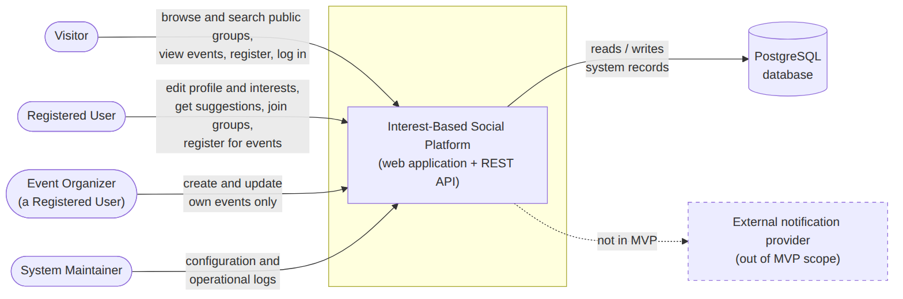
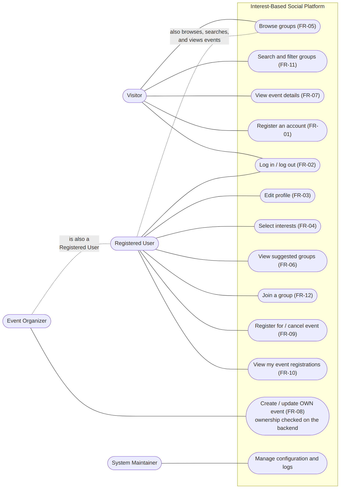
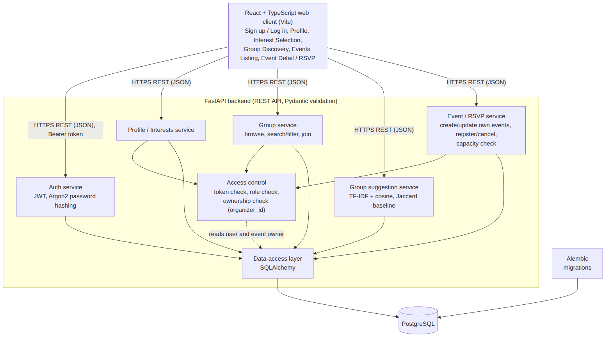
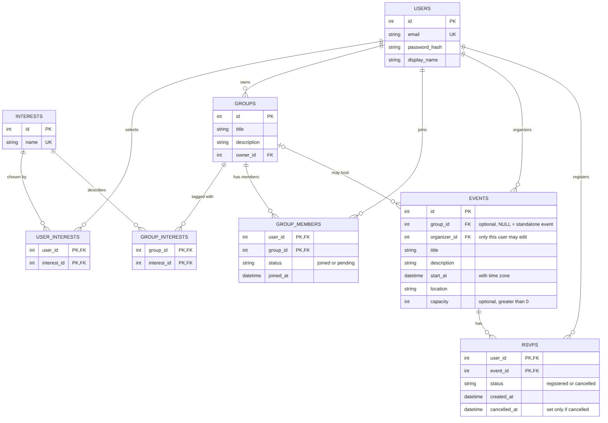

# System Architecture

**Project:** Interest-Based Social Platform (platform for interest-based group matching and offline social activities)

This document describes the system architecture and the initial data model. Requirement IDs (FR-xx, NFR-xx) refer to `docs/requirements.md`. The technology stack (React + TypeScript, FastAPI, PostgreSQL) follows `docs/technology-comparison.md`. Requirements and stack are still preliminary until reviewed by the supervisor, so this design may change.

## 1. Diagram Files

All diagrams are stored in the `diagrams/` folder. Each diagram has an editable source file (Mermaid, `.mmd`) and readable exports (`.svg`, `.png`) in `diagrams/exports/`. Sources can be edited in any text editor and previewed at https://mermaid.live.

| Diagram | Editable source | Exports |
| --- | --- | --- |
| System Context Diagram | `diagrams/system-context.mmd` | `diagrams/exports/system-context.svg`, `.png` |
| Use Case Diagram | `diagrams/use-case.mmd` | `diagrams/exports/use-case.svg`, `.png` |
| Component Diagram | `diagrams/component.mmd` | `diagrams/exports/component.svg`, `.png` |
| Entity-Relationship Diagram | `diagrams/er-diagram.mmd` | `diagrams/exports/er-diagram.svg`, `.png` |

To re-export after editing a source file (requires Node.js):

```
npx -p @mermaid-js/mermaid-cli mmdc -i diagrams/component.mmd -o diagrams/exports/component.svg
```

## 2. System Context Diagram



External actors: Visitor, Registered User, Event Organizer (a Registered User), and System Maintainer. All use the web application, which exchanges data with its own REST API, which persists records in PostgreSQL. An external notification provider is outside the MVP scope and is shown only as a dashed boundary.

## 3. Use Case Diagram
 


| Use case | Requirement | Visitor | Registered User | Event Organizer |
| --- | --- | --- | --- | --- |
| Register an account | FR-01 | Yes | | |
| Log in / log out | FR-02 | Yes | Yes | Yes |
| Edit profile | FR-03 | | Yes | Yes |
| Select interests | FR-04 | | Yes | Yes |
| Browse groups | FR-05 | Yes | Yes | Yes |
| View suggested groups | FR-06 (Should) | | Yes | Yes |
| View event details | FR-07 | Yes | Yes | Yes |
| Create / update own event | FR-08 | | | Yes (own events only) |
| Register for / cancel event | FR-09 | | Yes | Yes |
| View my event registrations | FR-10 | | Yes | Yes |
| Search and filter groups | FR-11 | Yes | Yes | Yes |
| Join a group | FR-12 (Should) | | Yes | Yes |

The System Maintainer additionally manages configuration and operational logs (not part of the public UI).

Joining a group (FR-12) and registering for an event (FR-09) are separate use cases: joining a group does not register the user for any event.

### 3.1 Organizer permissions

- An Event Organizer can create events and can **edit only the events they created**. The event's `organizer_id` identifies its owner.
- Ownership and authorization are **verified on the backend** for every create and update request. Hiding buttons in the frontend is not a security control.
- The backend checks, in order: (1) a valid access token is present, otherwise it returns 401; (2) the user is allowed to organize events, otherwise 403; (3) for update requests, `events.organizer_id` equals the current user's id, otherwise 403.
- Whether an organizer may also cancel a published event, and who is eligible to be an organizer, are open decisions in `docs/requirements.md` (Section 6, decision 5) and are not settled by this document.

## 4. Component Diagram



| Component | Responsibility | Related requirements |
| --- | --- | --- |
| React + TypeScript web client | Screens: Sign up / Log in, Profile, Interest Selection, Group Discovery, Events Listing, Event Detail / RSVP; responsive layout; keyboard-accessible forms | NFR-01 (usability), NFR-06 (responsive), NFR-07 (accessibility) |
| Auth service | Registration, login/logout, JWT issuing and verification, Argon2 password hashing | FR-01, FR-02, NFR-03 (security) |
| Profile / Interests service | Profile viewing and editing, interest selection | FR-03, FR-04, NFR-04 (privacy) |
| Group service | Browse groups, search and filter by text and interests, join a group and return membership status | FR-05, FR-11, FR-12, NFR-05 |
| Group suggestion service | Ranks groups by TF-IDF vectors of tags and descriptions with cosine similarity (Jaccard as baseline) and returns the shared tags; general browsing remains available if no suggestions can be produced | FR-06 |
| Event / RSVP service | Event details, create and update own events, register and cancel, capacity check, list of the user's registrations | FR-07, FR-08, FR-09, FR-10, NFR-05 |
| Access control | Token check, role check, ownership check (`events.organizer_id`) | NFR-03 |
| Data-access layer | SQLAlchemy models and queries | all |
| PostgreSQL | Persistent storage; Alembic manages schema migrations | all |

### 4.1 Cross-cutting decisions

- **Security (NFR-03):** protected endpoints require a valid access token; permissions and ownership are checked on the backend; passwords are stored only as Argon2 hashes; all input is validated with Pydantic; secrets are provided through environment variables and are never committed to Git.
- **Privacy (NFR-04):** public group and event responses use dedicated response models that contain only fields approved for public discovery. `password_hash` and `email` are never returned in public responses. Visibility of precise event locations follows the policy agreed by the team.
- **Performance (NFR-02):** list endpoints use pagination; indexes are planned on `group_interests(interest_id)`, `events(start_at)`, and `rsvps(event_id)`. The target (p95 ≤ 2 s at up to 20 concurrent users) is to be measured during testing, not assumed.
- **State consistency (NFR-05):** event registration and group joining are written in database transactions, and the API returns the confirmed state that is stored.

## 5. Initial Data Model (Entity-Relationship Model)



### 5.1 Tables

**users**

| Column | Type | Constraints |
| --- | --- | --- |
| id | integer | PK |
| email | string | unique, not null |
| password_hash | string | not null (Argon2 hash, never plain text) |
| display_name | string | not null |

**interests**

| Column | Type | Constraints |
| --- | --- | --- |
| id | integer | PK |
| name | string | unique, not null |

**user_interests** (many-to-many between users and interests)

| Column | Type | Constraints |
| --- | --- | --- |
| user_id | integer | PK, FK to users.id |
| interest_id | integer | PK, FK to interests.id |

**groups**

| Column | Type | Constraints |
| --- | --- | --- |
| id | integer | PK |
| title | string | not null |
| description | text | not null |
| owner_id | integer | FK to users.id, not null |

**group_interests** (many-to-many between groups and interests)

| Column | Type | Constraints |
| --- | --- | --- |
| group_id | integer | PK, FK to groups.id |
| interest_id | integer | PK, FK to interests.id |

**group_members** (membership, separate from event registration; supports FR-12)

| Column | Type | Constraints |
| --- | --- | --- |
| user_id | integer | PK, FK to users.id |
| group_id | integer | PK, FK to groups.id |
| status | string | not null, CHECK status IN ('joined', 'pending'), default 'joined' |
| joined_at | datetime | not null |

The MVP flow joins immediately (`joined`). The value `pending` is reserved for the case where the team decides on approval-based groups (open decision 3 in `docs/requirements.md`). Leaving a group is not modeled until it is added to the scope.

**events**

| Column | Type | Constraints |
| --- | --- | --- |
| id | integer | PK |
| group_id | integer | FK to groups.id, **nullable** |
| organizer_id | integer | FK to users.id, not null |
| title | string | not null |
| description | text | not null |
| start_at | datetime with time zone | not null |
| location | string | not null (venue/address or meeting instructions) |
| capacity | integer | nullable; CHECK capacity > 0 when set |

Does every event belong to a group? **No.** `group_id` is optional. An event may be linked to one group (shown with its group), or may be standalone, because the README and user flows describe browsing offline activities independently from groups and mention the linked group only "when applicable". If the team decides that every event must belong to a group, change `group_id` to NOT NULL. If a group is deleted, its events are kept and `group_id` becomes NULL.

Validation in the service layer (not a database constraint): `start_at` must be in the future when an event is created or published, and `capacity` is enforced as described in Section 5.3.

**rsvps** (event registrations)

| Column | Type | Constraints |
| --- | --- | --- |
| user_id | integer | PK, FK to users.id |
| event_id | integer | PK, FK to events.id |
| status | string | not null, CHECK status IN ('registered', 'cancelled') |
| created_at | datetime | not null |
| cancelled_at | datetime | nullable; set if and only if status = 'cancelled' |

Allowed RSVP status values and transitions:

| From | To | When |
| --- | --- | --- |
| (no row) | registered | The user registers for an available event (FR-09) |
| registered | cancelled | The user cancels when cancellation is permitted |
| cancelled | registered | The user registers again while the event is still available; the same row is updated, so there is never more than one row per user and event |

### 5.2 Relationships

- A user selects many interests, and an interest is chosen by many users (via `user_interests`).
- A group is tagged with many interests, and an interest describes many groups (via `group_interests`).
- A user owns many groups; each group has one owner.
- A user can join many groups, and a group has many members (via `group_members`).
- A group may host many events; an event belongs to at most one group (optional).
- A user organizes many events; each event has exactly one organizer.
- A user registers for many events, and an event has many registrations (via `rsvps`).

### 5.3 Integrity rules

- Table names `users` and `groups` are plural because `user` and `group` are reserved words in SQL.
- Composite primary keys in `user_interests`, `group_interests`, `group_members`, and `rsvps` prevent duplicates: one interest selection, one membership, and one RSVP row per user and target.
- RSVP status is limited to `registered` and `cancelled` by a CHECK constraint, and `cancelled_at` is set only for cancelled registrations.
- Group membership does not create an RSVP. The two tables are independent.
- If `events.capacity` is set, the number of RSVPs with status `registered` for the event must not exceed it. The Event / RSVP service enforces this in a database transaction that locks the event row, so simultaneous registration attempts cannot exceed the capacity (NFR-05). A waitlist is not part of the MVP because the requirements do not define one.
- Registration is allowed only for events whose `start_at` is in the future.
- Only the user in `events.organizer_id` may update the event (see Section 3.1).

## 6. Consistency with Requirements and Technology Stack

| Check | Result |
| --- | --- |
| Every Must functional requirement (FR-01 to FR-05, FR-07 to FR-11) maps to a use case and a component | Yes, see Sections 3 and 4 |
| Should requirements (FR-06 suggestions, FR-12 join group) are included | Yes, FR-06 in the suggestion service, FR-12 in the Group service and `group_members` |
| Non-functional requirements are mapped: usability NFR-01, performance NFR-02, security NFR-03, privacy NFR-04, state consistency NFR-05, responsive NFR-06, accessibility NFR-07 | Yes, see Sections 4 and 4.1 |
| Data model covers users, interests, groups, group membership, events, and RSVP registrations | Yes, see Section 5 |
| Layers match the selected stack (React, FastAPI, SQLAlchemy/Alembic, PostgreSQL) | Yes, see Section 4 |
| Suggestion component matches the chosen approach (TF-IDF + cosine, Jaccard baseline) | Yes |

## 7. Status and Limitations

- These are initial design diagrams. They should be reviewed with the team and may change during implementation.
- Column types and constraints are a first draft. Final definitions will be fixed in the first Alembic migration.
- Open decisions that affect the model remain with the team and supervisor: approval-based groups, leaving a group, event capacity and waitlists, organizer eligibility, and cancellation rules.
- Optional fields (for example user bio, group creation date, event drafts) are not modeled yet.
