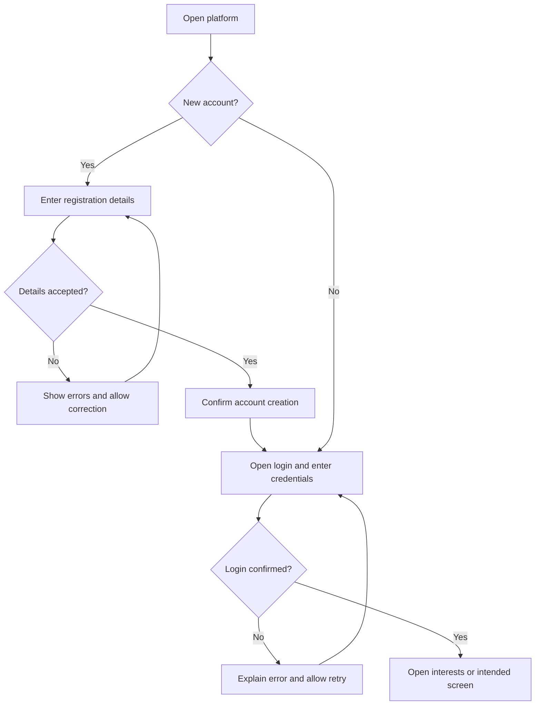
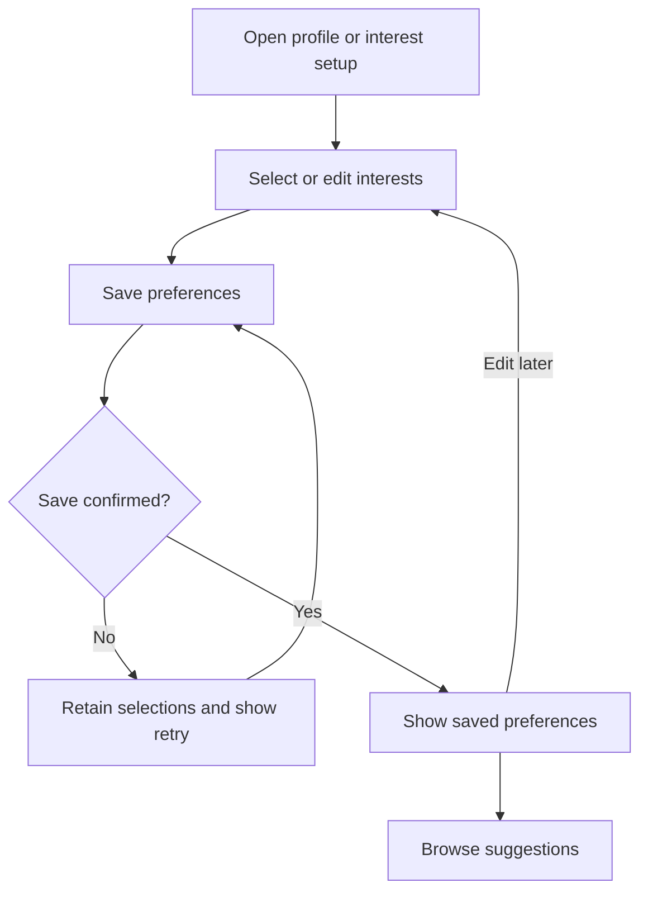
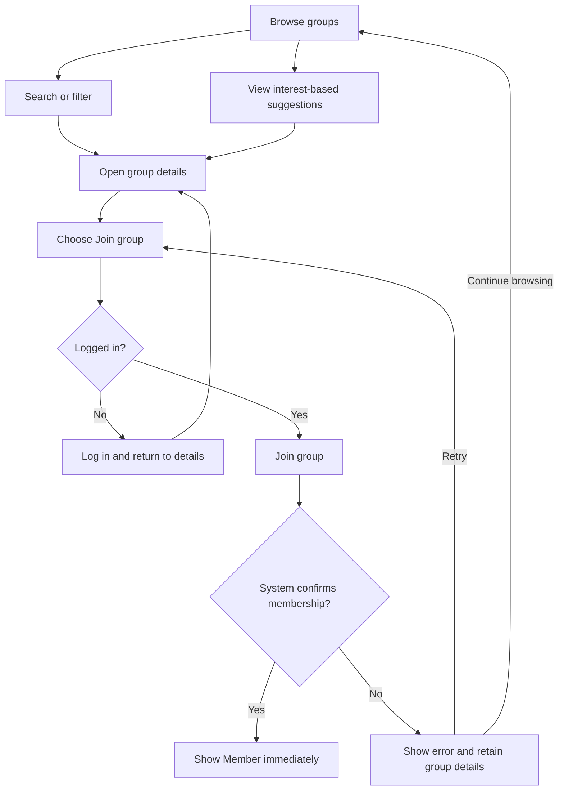
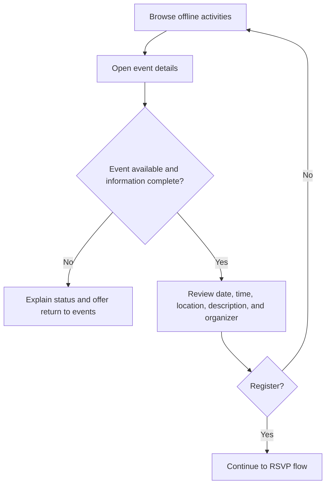
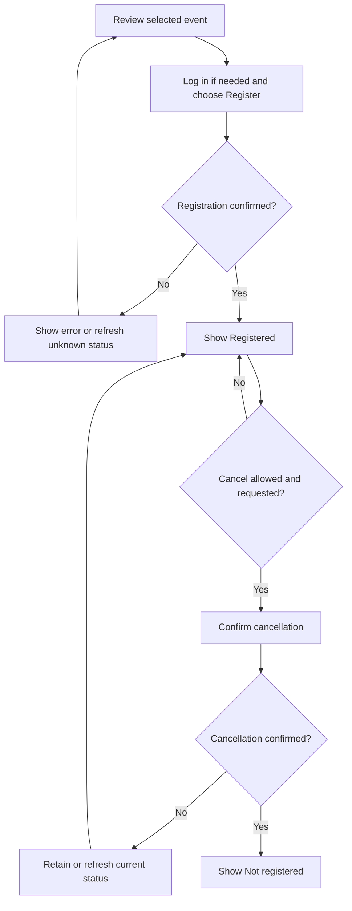
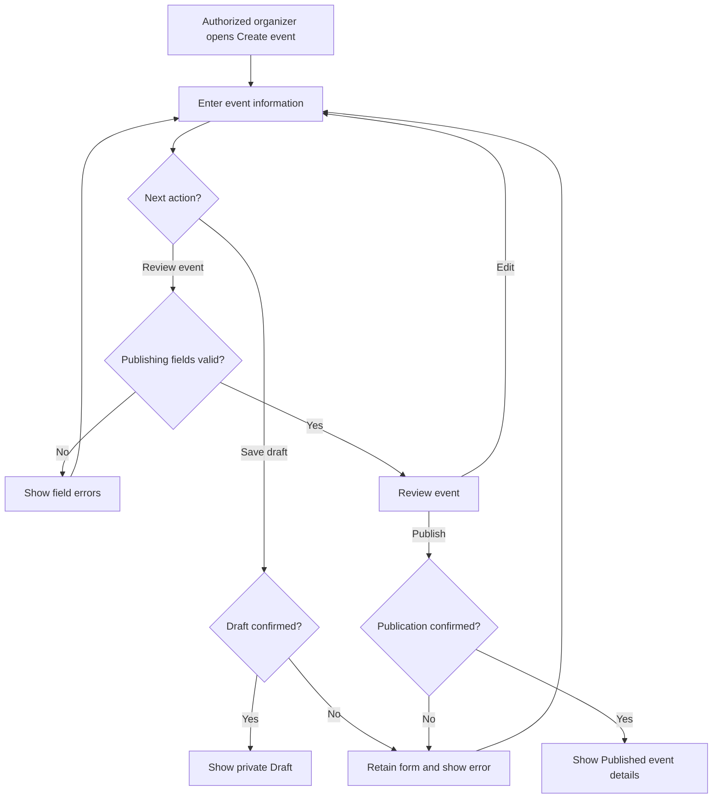

# Preliminary User Flows and UI Requirements

| Document attribute | Value |
| --- | --- |
| Project | Development of a Platform for Interest-Based Group Matching and Offline Social Activities |
| Academic context | Astana IT University, Software Engineering diploma project, SE-2424 |
| Task | IBS-13 — S4. Define User Flows and UI Requirements |
| Prepared by | Syndaly Yerzhan — Frontend Developer (listed as Yerzhan Syndaly in the README) |
| Date | 24 October 2026 |
| Status | Preliminary proposal; pending user validation, team review, and supervisor review |
| Intended use | Requirements discussion and preparation of a clickable Figma prototype |

## 1. Introduction

The proposed platform would help people discover groups through shared interests and find offline social activities. The initial research audience includes university students, particularly freshmen, and people who have recently moved to a new city. These audience choices and the value of the proposed platform require investigation with potential users.

This document describes candidate journeys, screen behavior, and interface requirements. **All behavior described below is proposed, not an approved or validated requirement.** The words *should* and *would* express design intentions for discussion. No interface implementation, usability testing, interview findings, or successful social outcomes are claimed. Example messages and prototype scenarios are illustrative content, not user quotations or records of actual activities.

The scope follows the [README](../README.md): registration and profiles, interest selection, group discovery, offline activity browsing, event creation, and participation. The [existing-systems review](existing-systems.md), especially Sections 7–8, informs questions about local relevance, first participation, understandable recommendations, and attendance changes. Its competitor observations do not validate our proposed interface. Technology choices remain preliminary; this document does not prescribe APIs, data storage, authentication providers, or a recommendation algorithm.

At drafting time, `docs/proposal.md` was absent from this checkout. The [IBS-6 proposal task](https://interest-based-group-matching.youtrack.cloud/issue/IBS-6/F1.-Write-Project-Proposal-and-Define-Project-Scope) describes its intended contents but provides no completed proposal to compare. Alignment is therefore based on the current README and the project brief; consistency with the proposal's eventual MVP and exclusions remains pending.

## 2. User Roles

These roles are initial interaction assumptions, not an approved permission model. An event organizer is proposed as a registered user with event-creation permission, rather than a separate account type. How that permission is obtained remains open.

| Role | Proposed interactions | Boundary requiring validation |
| --- | --- | --- |
| Guest | Open the platform, browse public groups and offline events, search public listings, view public details, and open registration or login. | Public visibility is assumed. Joining a group, recording an RSVP, editing a profile, and creating an event would require login. Decide what location and organizer information guests may see. |
| Registered user | Perform guest actions; manage a profile and interests; view interest-based suggestions; join eligible groups; register for events; inspect and cancel their own participation when permitted. | Group membership and event registration are separate. Membership does not automatically create an RSVP. Decide whether any events require group membership or approval. |
| Event organizer | Perform registered-user actions; prepare an event, save a draft, review it, and publish it if permitted. | Draft saving and direct publishing are prototype assumptions. Organizer eligibility, moderation, group ownership, and editing or cancelling published events need further definition. |

Administrative interfaces, payments, private messaging, automatic location detection, and attendance verification are not specified by these journeys. Their omission is a boundary of this document, not a finalized exclusion from the project.

## 3. Main User Flows

Each flow identifies the starting condition, proposed interaction, outcome, and recovery paths. Screen identifiers refer to Section 8. The diagrams summarize the steps; they do not represent implemented logic. Successful changes should be displayed only after confirmation from the system. While a request is in progress, the relevant action should indicate progress and prevent repeated submission.

### 3.1. Flow 1: Registration and Login

**Actor:** guest or returning registered user. **Entry:** landing screen or an action requiring login. **Outcome:** authenticated access, followed by interest selection for a new account or return to the intended screen.

| Step | User action | Proposed screen behavior |
| --- | --- | --- |
| 1 | Open the platform (S01). | Present the purpose, discovery links, and separate **Create account** and **Log in** actions. |
| 2 | Choose **Create account** (S02). | Present labeled registration fields. A display name, email, password, and password confirmation are provisional fields; show which are required. |
| 3 | Enter details and submit. | Explain the proposed password policy before submission; check required values, email format, and matching passwords. No password policy or identity-verification method is finalized here. |
| 4 | Correct invalid input. | Keep non-sensitive values and show field-specific guidance, such as “Enter an email address in the format name@example.com” or “Passwords do not match.” Do not imply that registration succeeded. |
| 5 | Receive account-creation confirmation and open **Log in** (S03). | Show “Account created. Log in to continue.” A separate login after registration is the proposed prototype path; automatic login and email verification remain questions for validation. |
| 6 | Enter login details and submit. | Show **Logging in…**. On confirmation, direct a new user to S04; return a returning user to discovery or the previously requested group/event. |
| 7 | Continue after login. | Preserve the intended destination, but require a new explicit **Join group** or **Register for event** action. Login alone should not record membership or participation. |

**Alternative and recovery paths:** returning users may open S03 directly. Missing login fields receive inline errors. Incorrect credentials receive “We could not log you in. Check your email and password.” Connectivity failures receive “We could not connect. Try again.” Registration rejection should use an approved, privacy-conscious message such as “We could not create the account. Try logging in or check your details.” Do not expose passwords or claim that an account exists for a supplied address. Account recovery, verification, and session policies need separate definition; do not add nonfunctional recovery links to the prototype.

### 3.2. Flow 2: Profile and Interest Selection

**Actor:** registered user. **Entry:** first login or profile navigation. **Outcome:** confirmed saved preferences that can be edited later.

| Step | User action | Proposed screen behavior |
| --- | --- | --- |
| 1 | Open the profile or interest setup (S04). | Display saved profile information and interests, or an explanation of interest selection for a new account. |
| 2 | Select or deselect interests. | Offer labeled checkboxes or equivalent accessible multi-selection controls. Show selected items clearly and keep unsaved selections distinct from saved preferences. |
| 3 | Choose **Save preferences**. | Validate any agreed selection rules and show **Saving…**. No minimum or maximum interest count is approved. For the initial prototype, allow zero selections and general browsing. |
| 4 | Receive confirmation. | Show “Your interests have been saved.” Refresh suggestions when available; do not promise a matching group. |
| 5 | Return later and edit interests. | Reopen the saved selection, allow changes, and repeat the save flow. Explain unsaved changes before leaving and offer **Keep editing** or **Discard changes**. |

**Alternative and recovery paths:** if the interest catalogue fails, show **Try again** and permit browsing without personalization. If saving fails, retain the current selections and state “Your changes have not been saved. Try again.” Do not show a saved state prematurely. For no selected interests, explain “Choose interests to help us suggest groups. You can also browse all groups.” The interest taxonomy, free-text options, profile fields, and visibility of interests require research.

### 3.3. Flow 3: Group Discovery and Recommendations

**Actor:** guest or registered user; login required to join. **Entry:** **Groups** navigation (S05). **Outcome:** a group is inspected and, if eligible, membership is confirmed.

| Step | User action | Proposed screen behavior |
| --- | --- | --- |
| 1 | Browse available groups. | Present group cards with names, interest tags, short descriptions, and a details link. Preserve the browse position when returning from details. |
| 2 | Search by name/topic or filter by interests. | Show the query, selected filters, result count when known, and **Clear filters**. For the prototype, text and interest filters narrow results together; multiple interests match any selected interest. Test whether this behavior is understandable. |
| 3 | View recommended groups. | For a user with saved interests, show a labeled suggestion area. An illustrative explanation is “Suggested because you selected board games.” Only display reasons supported by the actual selection. |
| 4 | Open group details (S06). | Show description, interests, proposed membership rules, available location context, and associated activities if any. Identify **Join group** as a separate action. |
| 5 | Choose **Join group**. | For guests, request login and return to the same group. For eligible users, show **Joining…**, then immediately show **Member** and “You have joined this group” once the system confirms membership. There is no organizer approval step. |

**Alternative and recovery paths:** if no groups match, show “No groups match your search. Try another interest or clear filters.” If there are no useful recommendations, retain all-group browsing and explain “No suggestions are available for your current interests.” A recommendation failure should not hide a successfully loaded catalogue. If joining fails, retain details and allow retry. If already a member, show **Member** without another join action. The base prototype assumes immediate membership after successful system confirmation, without organizer approval or a pending-request state. Private groups, approval-based membership, leaving a group, and unavailable-group handling remain future policy questions outside this flow.

Recommendations are a proposed interface capability, not evidence of a working matching engine. Figma may use clearly labeled illustrative suggestions; ranking, location constraints, and recommendation effectiveness remain undecided.

### 3.4. Flow 4: Offline Event Discovery

**Actor:** guest or registered user. **Entry:** **Events** navigation (S07) or a group's activities. **Outcome:** enough event information is available to decide whether to register.

| Step | User action | Proposed screen behavior |
| --- | --- | --- |
| 1 | Browse available offline activities. | Show event cards with a title, date, time, location summary, and organizer name. An optional interest filter can reuse the discovery pattern; additional date or location filters require validation. |
| 2 | Inspect a card and choose **View event**. | Open S08 without recording participation. Keep the previous listing context for return navigation. |
| 3 | Check event information. | Display the full description, date, time with timezone, physical venue/address or meeting instructions, and organizer. Include linked group and participation conditions when applicable. |
| 4 | Decide the next action. | Offer **Register for event** when eligible, **Log in to register** for a guest, or a clear unavailable status. Browsing may continue without registration. |

**Alternative and recovery paths:** distinguish “No upcoming activities are listed yet” from “No events match your filters.” If an event cannot be loaded, offer **Try again** and **Back to events**. For a removed event, explain “This event is no longer available.” If essential date or location information is missing, show “Event details are incomplete” and withhold registration until clarified. Exact address visibility before login, meeting instructions, cancelled-event visibility, and support for multiple cities need validation.

### 3.5. Flow 5: Event Participation / RSVP

**Actor:** registered user; guests enter through login. **Entry:** event details (S08). **Outcome:** a confirmed participation record or confirmed cancellation, visible on the event and in S09.

| Step | User action | Proposed screen behavior |
| --- | --- | --- |
| 1 | Select an event and review its conditions. | Show registration availability and any cancellation restriction before the user acts. Group membership alone should not imply registration. |
| 2 | Choose **Register for event**. | If needed, request login and return to the event for an explicit registration action. Otherwise show **Registering…** and prevent duplicate submissions. |
| 3 | Receive the result. | On confirmation, show **Registered** and “You are registered for this event.” Keep event time and meeting information available. |
| 4 | View participation status. | Show the same status in event details and **My activities** (S09), with a link back to the event. RSVP records intention; it does not verify physical attendance. |
| 5 | Choose **Cancel participation**, when allowed. | Explain the effect in a confirmation dialog with **Keep registration** and **Cancel participation**. Show **Cancelling…** only after confirmation. |
| 6 | Receive cancellation confirmation. | Show “Your participation has been cancelled” and **Not registered**. Return to a registration option only if the event remains open and policy allows rejoining. |

**Alternative and recovery paths:** already-registered users see their status rather than another registration action. Closed registration should explain “Registration is closed for this event.” Show **Full** only if capacity limits are adopted and confirmed. If cancellation is disallowed, explain the applicable condition, such as “Cancellation is closed for this event.” On a confirmed failed cancellation, keep **Registered**. If a timeout leaves an action's outcome unknown, show “We could not confirm your participation status. Refresh status before trying again,” retrieve the current state, and avoid assuming success or failure. Waitlists, approval, cancellation deadlines, eligibility, and rejoining rules are unresolved; the base prototype assumes direct registration for an open event.

### 3.6. Flow 6: Event Creation

**Actor:** registered user with proposed organizer permission. **Entry:** **Create event** (S10). **Outcome:** a confirmed private draft or a confirmed published listing.

| Step | User action | Proposed screen behavior |
| --- | --- | --- |
| 1 | Choose **Create event**. | Check the current permission; guests return through login, while users without permission receive an explanation. Do not imply that organizer eligibility has been approved. |
| 2 | Enter event information. | Provide labeled title, description, date, time, timezone, and physical location fields. Show organizer identity from the signed-in context; whether users can represent a club is unresolved. |
| 3 | Choose **Save draft** or **Review event**. | For the prototype, a draft needs a title but may omit publishing fields. **Review event** checks all publishing fields, a valid future date/time, and meaningful venue or meeting information. Exact field limits remain undecided. |
| 4 | Correct validation errors or review the event (S11). | Explain missing values beside fields, preserve entered content, and offer an error summary. Example: “Enter a physical location or meeting point.” A review displays the proposed public information before publishing. |
| 5 | Save the draft or choose **Publish event** after review. | **Save draft** confirms a private **Draft** without creating a public listing. **Publish event** shows **Publishing…** and displays **Published** only after confirmation. |
| 6 | Open the result. | A draft remains available for editing in the proposed organizer view of S09. A published event opens S08 with “Your event has been published” and a link from the organizer's activity list. |

**Alternative and recovery paths:** saving or publishing errors keep entered values and offer retry. If the publish outcome is uncertain, check whether the event was created before offering another publish attempt. Leaving an unsaved form offers **Keep editing** or **Discard changes**; do not promise recovery after a reload or closed session. Draft storage, expiration, organizer permission, group association, and moderation are open questions. A title-only draft is explicitly a prototype choice. If review approval is later required, introduce **Submitted for review** and withhold the public listing until approval; it is not part of the base direct-publication scenario.

## 4. UI Requirements

The following are candidate interface requirements for the prototype, subject to validation and scope review.

| Area | Proposed requirement and expected behavior |
| --- | --- |
| Navigation | Provide consistent **Groups**, **Events**, and authentication links. Signed-in users can reach **Profile** and **My activities**; eligible organizers can reach **Create event**. Indicate the current destination and provide a clear route back from details. Preserve discovery queries and filters when returning. |
| Forms and input validation | Use persistent labels, required/optional indicators, format hints, and errors adjacent to their fields. Validate on submission and show relevant corrections after interaction; avoid errors before a user starts. Preserve non-sensitive inputs after failure. Show a summary for multiple errors and direct focus to it or the first invalid field. Validation should be checked by the system as well as presented in the interface; no technical mechanism is selected. |
| Search and filtering | Provide a labeled search control, explicit **Search** action, interest selections, result feedback, and **Clear filters**. An explicit action is the initial prototype choice; instant search remains open. Keep selections during loading and errors. Distinguish no matches from unavailable data; never present an error as zero results. |
| Group cards | Show name, brief purpose, interest tags, available locality context, and a clear details link. Display current membership when known. Member counts and imagery are optional pending evidence; missing images should not prevent understanding. |
| Event cards | Show title, readable date/time, location summary, organizer, and a details action. Display **Registered**, **Registration closed**, or **Cancelled event** when applicable and known. Keep full scheduling and venue information accessible in details. |
| Buttons and feedback | Use action-specific labels such as **Save preferences**, **Join group**, and **Publish event**. Distinguish primary and secondary actions visually. Show progress on the affected control, prevent repeated submission, explain unavailable actions, and provide a recovery action after failure. Keep important feedback visible and available to assistive technology. |
| Participation status | Use text labels consistently: **Not registered**, **Registering…**, **Registered**, and **Cancelling…**. **Registration closed** describes the event; it may coexist with an existing **Registered** status. Distinguish **Cancelled event** from a user's cancelled participation. Never rely on color alone. |
| Consistent updates | After confirmed membership, preference, or RSVP changes, update relevant views. When an outcome is unknown, offer a status refresh and do not display an unsupported success message. Session expiry should explain the need to log in again and return to the intended context. |
| Responsive layouts | Retain the same core information and actions across device sizes. Reflow navigation, cards, filters, and forms without clipping essential content or requiring horizontal page scrolling. Section 6 describes candidate arrangements. |
| Basic accessibility | Provide clear labels, logical headings, keyboard access, visible focus, readable contrast, understandable errors, and comfortably separated controls. Section 7 defines prototype review considerations. |

## 5. Interface States

**Default** means the screen is ready for interaction; **loading** means information or an action is pending; **empty** means a successful retrieval has no relevant content; **error** means an operation failed; **success** means a result is confirmed. These states may apply to individual regions rather than replacing the entire screen. Empty forms are default states, not retrieval errors. All copy below is proposed English copy; language choices need validation.

### 5.1. Entry, authentication, and preferences

| Screen | Default state | Loading state | Empty state | Error state | Success state |
| --- | --- | --- | --- | --- | --- |
| S01 — Landing | Purpose, discovery links, **Create account**, and **Log in**. | If featured content is requested, show “Loading activities…” while keeping navigation usable. | “No activities are listed yet. Browse groups to explore shared interests.” | “Activities could not be loaded. Try again.” Keep the rest of the landing screen usable. | Successfully retrieved group/event previews appear; no generic success alert is necessary. |
| S02 — Registration | Blank labeled form and link to login. | **Creating account…**; prevent another submission. | Not applicable to retrieval; a blank form is default. Missing fields are validation errors. | “Enter your email address”; “Passwords do not match”; or “We could not create the account. Try logging in or check your details.” | “Account created. Log in to continue.” Open or link to S03. |
| S03 — Login | Email and password fields with **Log in**. | **Logging in…**; keep context for return. | No saved login information is normal; show the standard form. | “We could not log you in. Check your email and password.” For connectivity: “We could not connect. Try again.” | Return to the intended screen or S04; “You are logged in.” Do not automatically join or register. |
| S04 — Profile and interests | Saved profile and selected interests with an edit action. | “Loading your profile…” or **Saving…**, according to the operation. | “You have not selected any interests yet.” Offer selection and general browsing. If the catalogue itself is empty, explain that interests are not yet available. | “Your interests could not be loaded” or “Your changes have not been saved. Try again.” Retain current edits after a save failure. | “Your interests have been saved.” Display confirmed selections. |

### 5.2. Discovery and details

| Screen | Default state | Loading state | Empty state | Error state | Success state |
| --- | --- | --- | --- | --- | --- |
| S05 — Group discovery | Group results, search, filters, and a separate suggestions area when appropriate. | “Loading groups…”; preserve query and selections. Load suggestions independently where possible. | “No groups match your search. Try another interest or clear filters.” For no catalogue: “No groups are listed yet.” For suggestions: “No suggestions are available for your current interests.” | “Groups could not be loaded. Try again.” A suggestions-only failure says “Suggestions are unavailable. You can still browse all groups.” | Show results and count when known, for example “3 groups match your search.” Use illustrative counts only in the prototype. |
| S06 — Group details | Description, interests, membership rules, associated activities, and join control or membership status. | “Loading group…” or **Joining…**. | With no associated events: “This group has no upcoming activities.” Missing group data is an unavailable/error state, not an empty group. | “This group is no longer available” or “We could not join the group. Try again.” | **Member** and “You have joined this group.” This does not imply registration for an event. |
| S07 — Event discovery | Upcoming event cards and supported filters. | “Loading events…”; keep selected filters. | “No upcoming activities are listed yet” or “No events match your filters. Clear filters to see more.” | “Events could not be loaded. Try again.” | Show retrieved events and result feedback; a separate success alert is unnecessary. |
| S08 — Event details and RSVP | Date, time/timezone, location, description, organizer, and current participation/availability. | “Loading event…”, **Registering…**, **Cancelling…**, or “Refreshing participation status…”, as applicable. | Optional related activities may say “No other activities are listed.” No participation record displays **Not registered**, rather than an error. | “This event is no longer available”; “Event details are incomplete”; or “We could not confirm your participation status. Refresh status before trying again.” Retain a confirmed status on a definite failed action. | “You are registered for this event” with **Registered**, or “Your participation has been cancelled” with **Not registered**. |

### 5.3. Personal activities and event authoring

| Screen | Default state | Loading state | Empty state | Error state | Success state |
| --- | --- | --- | --- | --- | --- |
| S09 — My activities | Participant registrations with event links; a clearly separate organizer view for drafts and published events when permitted. | “Loading your activities…” | Participant: “You have not registered for any events yet. Explore events.” Organizer: “You have not created any events yet.” Offer **Create event** only when eligible. | “Your activities could not be loaded. Try again.” Do not replace unknown records with a false empty state. | Display confirmed registrations and, for organizers, draft/publication labels. This is a summary of saved state, not proof of attendance. |
| S10 — Event form | Blank creation fields or an existing draft; clear **Save draft** and **Review event** actions. | “Loading draft…” or **Saving draft…**. | A new blank form is default. An unavailable requested draft shows “This draft is no longer available,” with an option to start a new event. | “Enter an event title”; “Choose a future date and time”; or “Your draft could not be saved. Your entries are still here.” A permission failure says “Event creation is not available for your account.” | **Draft** and “Your draft has been saved.” A valid review action opens S11; it does not publish. |
| S11 — Event review and publication | Summary of all proposed public fields with **Edit** and **Publish event**. | **Publishing…**; prevent a second publish request. | Without draft/form content: “There is no event to review. Return to Create event.” | “Your event could not be published. Review your details and try again.” For unknown outcome, offer a status check before another attempt. | **Published**, “Your event has been published,” and a route to S08. |

Confirmation dialogs should follow the same principles: clear title and consequence, named actions, progress where needed, and an inline failure explanation. An RSVP cancellation dialog is a proposed component of S08, not another mandatory full screen. Event availability labels such as **Cancelled event** or **Registration closed** are domain states, not loading or network errors.

## 6. Responsive Design

Device categories describe candidate layouts, not approved breakpoint values. The layout should change when its content no longer fits comfortably. Exact thresholds, navigation patterns, and spacing require Figma exploration and later testing on representative viewports.

| Context | Proposed adaptation |
| --- | --- |
| Desktop screens | Use a constrained readable content width; show navigation labels and a multi-column card area when space allows. Filters may sit beside results. Event details may place a participation summary alongside the main content without separating it from the event context. |
| Tablet screens | Reduce card columns according to available width; move filters above results or into an accessible expandable panel. Keep labels and actions readable in portrait and landscape. Avoid assuming that tablet users have a mouse. |
| Mobile screens | Use a single-column content order; place essential event facts before the registration action. Navigation may collapse into a labeled menu with a visible current destination. Filters may open a panel with **Apply filters**, **Clear filters**, and a clear close action. Stack form controls and allow interest labels to wrap. |

Across sizes, retain account, discovery, RSVP, and organizer actions when permitted. A collapsed menu or filter panel should support keyboard use, announce its state, and restore focus when closed. Any sticky registration control considered in Figma should avoid covering content, errors, or focused elements. Forms should remain usable with the on-screen keyboard, zoom, enlarged text, and long event titles or addresses. Essential details should not depend on hover, cropped text, or horizontal card carousels.

## 7. Accessibility

These are proposed baseline design considerations, not a claim of accessibility compliance. The team should agree a formal accessibility target during requirements analysis. Figma can illustrate focus and error behavior; the implemented interface would later require keyboard, contrast, zoom, and assistive-technology checks.

| Consideration | Proposed behavior and prototype review point |
| --- | --- |
| Clear labels and structure | Use persistent form labels, meaningful headings, and descriptive link/button names. Mark required fields in text. Do not use placeholders, icons, or color as the only explanation. Describe images that convey information; treat decorative images as decorative. |
| Keyboard navigation | Make navigation, interests, filters, cards, forms, and dialogs operable by keyboard in a logical order. Use appropriate control semantics; avoid a clickable card containing conflicting nested actions. Provide a route past repeated navigation in implementation. |
| Visible focus | Show a clear focus indicator on interactive controls. Design focus order and destinations for dialogs, error summaries, and navigation changes. Restore focus to the trigger after closing a dialog or panel; prevent focus from moving into obscured background content while a modal is open. |
| Text contrast and readability | Choose foreground/background combinations with sufficient contrast and verify them with a contrast checker against the agreed accessibility target. Keep body text readable and support enlarged text. Do not assume that a selected palette passes without measurement. |
| Understandable errors | State what went wrong and how to correct it: “Enter a physical location or meeting point” is preferable to “Invalid input.” Associate messages with the relevant fields and retain valid entries. Explain unavailable actions rather than relying on a disabled appearance. |
| Buttons and touch targets | Provide comfortably sized, well-spaced interaction areas for primary actions, checkboxes, filter chips, and icon controls. Avoid precise tapping and accidental activation of adjacent actions. Validate exact sizes and spacing against the chosen accessibility target and device tests; no measured compliance is claimed here. |
| Status feedback | Pair status colors with text. In implementation, announce meaningful loading, validation, and success updates without unexpectedly moving focus. Keep confirmations available long enough to read; persistent participation labels should remain after a transient message disappears. |

## 8. Preliminary Screen List

These identifiers are suggested Figma frame references, not final routes or a commitment to separate pages. Combine screens or use panels only if the journeys remain understandable.

| ID | Proposed screen | Primary purpose and prototype connections |
| --- | --- | --- |
| S01 | Landing / entry | Explain the platform; connect to S02, S03, S05, and S07. |
| S02 | Registration | Create an account; show validation and submission states; connect to S03. |
| S03 | Login | Authenticate; connect to S04 or the intended group/event screen. |
| S04 | Profile and interest setup/edit | Select and save interests; connect to S05 and support later editing. |
| S05 | Group discovery and suggestions | Browse/search/filter groups; connect to S06. Suggestions are a region of this screen. |
| S06 | Group details | Explain a group, show membership, and connect to its available events. |
| S07 | Offline event discovery | Browse activities; connect to S08. |
| S08 | Event details and RSVP | Review event information, register, view status, and cancel when allowed. Include a cancellation confirmation variant. |
| S09 | My activities | Inspect personal registrations; organizer variant provides draft and published-event links. |
| S10 | Create/edit event draft | Enter information and validate it; connect to S11 or save a draft. |
| S11 | Event review | Review proposed public content; return to S10 or publish and open S08. |

For the initial clickable prototype, annotate role, entry condition, state, and destination on each frame. Include the six main paths, invalid registration, failed login, unsaved interests, no matching groups, unavailable event, failed/unknown RSVP, cancellation, incomplete event form, and saved draft. Use clearly identified fictional sample content. Create reusable card, form-field, status, button, and feedback components with variants reflecting Section 5. These are prototyping instructions, not evidence that Figma frames already exist.

## 9. Assumptions and Questions for User Validation

The following assumptions should be tested with potential participants and organizers, then reconciled with the proposal and supervisor feedback. They should not be converted directly into approved requirements.

| ID | Current assumption or unresolved question | Proposed validation and consequence |
| --- | --- | --- |
| A01 | Public browsing helps newcomers evaluate the platform before registration. | Compare browse-first and login-first prototypes with freshmen and recent arrivals; decide which information can be public. |
| A02 | A display name and email/password registration are sufficient for an initial journey. | Discuss identity, privacy, age range, verification, recovery, and university affiliation; agree necessary fields and authentication policy. |
| A03 | Users can browse with zero interests; a controlled multi-selection list is an adequate starting point. | Observe interest selection and later editing; revise taxonomy, limits, optionality, language, and profile visibility. |
| A04 | Text search plus interests is enough for early discovery; multiple interests use an any-match rule. | Ask participants to find a relevant group and explain the results; assess location, language, date, experience, and other filters before adding them. |
| A05 | Suggestions based on declared shared interests are understandable and useful. | Compare clearly explained illustrative suggestions with manual browsing; use evidence to decide whether personalization is needed and how to evaluate it. No algorithm is selected. |
| A06 | Groups are joined immediately, while event registration is a separate decision. | Walk through open/private groups and event access with users and organizers; define approval, membership prerequisites, leaving, and eligibility if needed. |
| A07 | Open events use direct RSVP and show a persistent confirmed status. | Ask organizers to reconstruct registration and attendance changes; decide capacity, waitlists, approval, cancellation, rejoining, and treatment of cancelled events. |
| A08 | Date, timezone, physical venue, description, and organizer are sufficient to evaluate an activity. | Test first-attendance scenarios; identify needed meeting instructions, cost information, accessibility details, organizer identity, and location privacy. |
| A09 | An organizer is a registered user with additional permission. | Review who may publish and represent a group with the team and supervisor; define organizer eligibility and responsibility before implementation. |
| A10 | Title-only private drafts and review before direct publishing are suitable. | Walk through event creation with organizers; decide draft rules, persistence, moderation, edit/cancel workflows, and whether the proposed workflow fits the MVP. |
| A11 | The proposed navigation, mobile layouts, and English copy are understandable. | Test task completion on representative viewport sizes and with keyboard use; ask about preferred languages and revise labels, focus order, spacing, and layout thresholds. |
| A12 | The journeys fit the eventual proposal and project constraints. | Compare this document with `docs/proposal.md` when available and with the requirements work; resolve MVP, exclusions, privacy/reporting needs, and technical dependencies with the supervisor. |

Suggested research tasks are to find and join a relevant group, explain a recommendation, evaluate a first offline activity, register and cancel, and create an event with incomplete information. Record observed difficulties and contradictory feedback, rather than asking only whether participants like a screen. Participant recruitment, consent, study methods, and findings should be documented separately. No such study has been reported in this document.

## 10. Conclusion

This preliminary specification connects six proposed journeys with candidate screen behavior, interface states, responsive arrangements, and accessibility considerations. It provides a reviewable basis for the upcoming Figma prototype while retaining uncertainty about permissions, recommendations, participation rules, event publishing, and the final project scope. User research, proposal reconciliation, and supervisor review should precede approval of the requirements and technical design.

### IBS-13 acceptance-criteria verification

The following six criteria were read from [IBS-13 — S4. Define User Flows and UI Requirements](https://interest-based-group-matching.youtrack.cloud/issue/IBS-13/S4.-Define-User-Flows-and-UI-Requirements) on **24 October 2026**. Status describes this documentation artifact; the YouTrack issue and its checkboxes have not been changed. “Covered” means documented, not implemented or validated.

| Acceptance criterion from YouTrack | Status | Evidence |
| --- | --- | --- |
| Registration and interest selection flows are documented. | Covered | Sections 3.1–3.2, including login, invalid input, saving, and later editing. |
| Group search and recommendation flows are documented. | Covered | Section 3.3, with filtering, suggestions, details, joining, and recovery paths. |
| Event viewing and RSVP flows are documented. | Covered | Sections 3.4–3.5, including event information, status, and cancellation. |
| Loading, error, and empty states are specified. | Covered | Section 5 covers S01–S11, alongside default/success states and concrete messages. |
| Responsive behavior and basic accessibility considerations are addressed. | Covered | Sections 6–7; candidate layouts and accessibility review points are explicit. |
| docs/user-flows.md is created and committed. | Satisfied by this commit | This file is included in the IBS-13 documentation commit; the commit identifier is recorded in repository history. |

The additional requested event-creation journey is in Section 3.6; role assumptions, UI requirements, and prototype screen references are in Sections 2, 4, and 8. The working branch was verified as `IBS-13-user-flows`. This revision is committed on that branch for review; no pull request, merge, or issue-state update is included.
